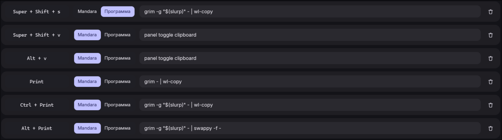

# Фиксы возможных проблем

## 1 Встроенные скриншоты Mandara

**Ошибка:** `screenshot: не удалось снять экран: invalid capture dimensions`

**Решение:** замена на **grim** делает снимок, **slurp** выбирает область, **wl-clipboard** копирует в буфер, **swappy** рисует поверх снимка.

Установка:

```bash
sudo pacman -S grim slurp wl-clipboard swappy
```

**Замена втроенных биндов Mandara:**

```bash
# весь экран в файл
grim ~/Pictures/Screenshots/$(date +%F_%H-%M-%S).png

# выделенная область в файл
grim -g "$(slurp)" ~/Pictures/Screenshots/$(date +%F_%H-%M-%S).png

# выделенная область сразу в буфер обмена
grim -g "$(slurp)" - | wl-copy

# выделить область, нарисовать стрелки и текст, потом сохранить или скопировать
grim -g "$(slurp)" - | swappy -f -

# конкретный монитор (имена смотрите в wlr-randr)
grim -o DP-1 shot.png
```

**Замена биндов в самом конфиге:**

```bash
# весь экран в буфер
bind=NONE,Print,spawn_shell,grim - | wl-copy

# область в буфер
bind=SUPER,Print,spawn_shell,grim -g "$(slurp)" - | wl-copy

# область в swappy (с редактированием)
bind=ALT,Print,spawn_shell,grim -g "$(slurp)" - | swappy -f -

# область в файл
bind=CTRL,Print,spawn_shell,grim -g "$(slurp)" ~/Pictures/Screenshots/$(date +%F_%H-%M-%S).png
```

**Пример замены:**




